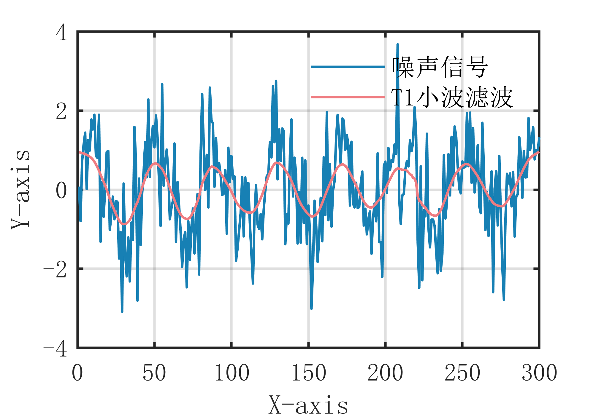

# MATLAB | Digital Signal Processing | T1 Wavelet Filtering Algorithm | Includes data and plotting code | Directly Useable

1. Basic Definition
The T1 wavelet filtering algorithm is a signal denoising algorithm based on wavelet transform. It can effectively remove noise from the signal while preserving its main characteristics. The main idea of this algorithm is to decompose the signal into multiple wavelet coefficients at different scales, and then remove noise by thresholding the wavelet coefficients. Specifically, the steps of the T1 wavelet filtering algorithm are as follows:
- Decompose the original signal into multiple wavelet coefficients at different scales.
- Threshold the wavelet coefficients at each scale, setting coefficients below a certain threshold to zero and retaining those greater than or equal to the threshold.
- Reconstruct the processed wavelet coefficients to obtain the denoised signal.
- Repeat the above steps until the stopping criterion is met. The advantage of the T1 wavelet filtering algorithm is that it can preserve the main characteristics of the signal while removing noise, effectively processing non-stationary signals and nonlinear signals. However, it requires selecting appropriate thresholds and stopping criteria to avoid affecting the reconstruction effect of the signal.
2. Definition and Outline Effects
The outline effects are as follows:
\n        \n  
Video tutorial operation:
\n        \n          \n          \n          \n          \n            To view this video please enable JavaScript, and consider upgrading to a\n            web browser that\n            supports HTML5 video\n

## Images

<!-- PAYMENT_BLOCK -->

## Get this dataset

- Payment link (Stripe): [Buy now](https://buy.stripe.com/3cs8yP7sY87d0vu9AB)
- Payment QR code: 

<!-- /PAYMENT_BLOCK -->
